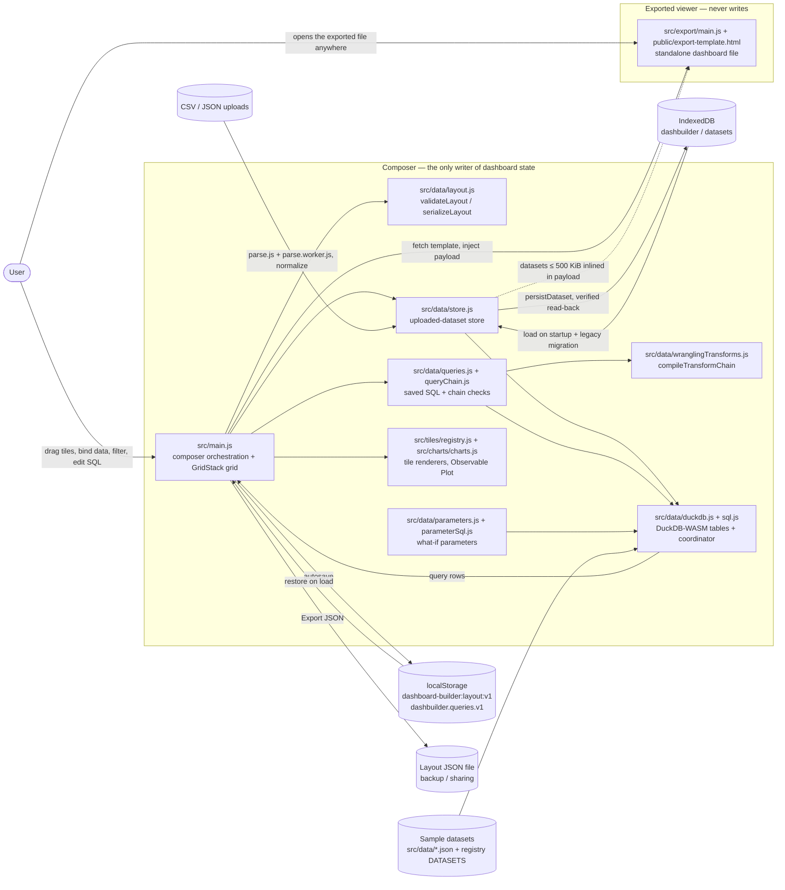
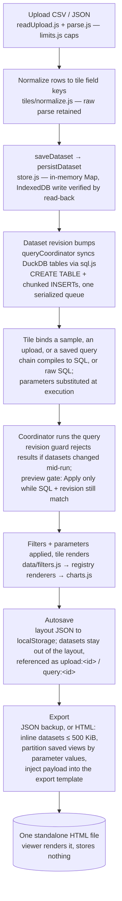

# Dashboard Builder — Architecture Map

**Verified:** 2026-11-03, against main `b74d52618c65142018f4bb2fc9d88ec2293038dd`
(merge of PR #29, UX-4 P1 interaction set, 2026-11-03T08:30:19Z; test baseline
**UNVERIFIED at this HEAD** — suites were not run for this draft; the last
recorded counts, node 169 / browser 139, predate this HEAD, while the render
sweep's 72 cases are grounded in README “Run and verify” + `tests/render-sweep.mjs`)
— root tree, `package.json`, entry points, and the data/store/SQL/export
modules were read from code at that commit via the GitHub connector.
Re-verify before trusting this map after any parameters, export, or UX slice
merges — PR #32 (parameters S1-B) is open against this HEAD and will move §3/§5.

> ⚠️ **Standing warning 1:** `public/export-template.html` is a *generated*
> artifact (`vite.export.config.js`, via `npm run build:export-template` /
> the `predev` hook). Starting Vite directly, bypassing the npm scripts,
> serves whatever stale template is on disk and exports silently embed it.
> Always launch through `npm run dev` / `npm run build`.
>
> ⚠️ **Standing warning 2:** the pre-theme-era storage — IndexedDB database
> `klaro-dashboard` and localStorage keys `klaroDash.*` / `dashbuilder.datasets.v1`
> — is a retained recovery source, migrated once on startup and then left
> alone by design (README “Persistence and migration”; `src/data/store.js`).
> Do not delete it as cleanup until a migration path exists.

---

## 1. The system on one screen

**The one-sentence version:** a fully client-side composer turns uploads and
sample data into a GridStack dashboard whose tiles are fed by an in-browser
DuckDB, persists layout + queries to localStorage and datasets to IndexedDB,
and exports either JSON or a single self-contained HTML file whose viewer
renders the same charts and writes nothing back.

---

## 2. From an upload to an exported dashboard, stage by stage

Orchestration is `src/main.js` (the composer shell in `index.html`: palette,
page tabs, `.grid-stack`, header actions) over the `src/data/` modules.
There is no server and no account — every stage runs in the browser, and
DuckDB-WASM itself is loaded lazily by dynamic `import()` only when a SQL
tab or query tile first needs it (`src/data/duckdb.js`).

Failure behaviour, as built: a dataset that cannot persist is marked
session-only and surfaced (`storageIssues()` + the header persistence
warning in `index.html`) rather than silently lost; a query whose datasets
changed mid-execution throws and must be re-run; layout import validates
the whole file first (`validateLayout`), snapshots the previous layout +
queries to a `:recovery` key, and rolls back imported datasets on failure.

---

## 3. Module tour — “if you want X, start here”

All application code lives in `src/`; the composer entry is `index.html` →
`src/main.js`.

| Start here | Owns | Notes |
|---|---|---|
| `index.html` + `src/main.js` | Composer shell + all orchestration: palette, pages, grid, header actions (Data, Filters, saved views, Export HTML/JSON, Present, Theme, Templates, Save/Import/Clear) | `main.js` is ~94 KB and imports nearly everything — start from its imports, not top-to-bottom. It dynamically imports `duckdb.js` so WASM never slows first load |
| `src/data/layout.js` | The layout contract: `validateLayout`, `serializeLayout`, data refs (`upload:<id>`, `query:<id>`, sample keys) | Rejects prototype-pollution keys and duplicate column names; dataset IDs that collide case-insensitively cancel the import with existing data retained |
| `src/data/store.js` | Uploaded datasets: in-memory Map (source of truth, sync reads) + IndexedDB `dashbuilder`/`datasets` via `idb` | Layouts reference datasets by id so autosave stays lean. `EXPORT_INLINE_BYTES` = 500 KiB is the export inlining threshold. Owns the legacy migrations (localStorage keys + `klaro-dashboard` DB) |
| `src/data/queries.js` | Saved SQL queries: in-memory Map + localStorage `dashbuilder.queries.v1` | Every Apply in the SQL tab saves a **new immutable** entry; unreferenced queries are pruned |
| `src/data/queryChain.js` | Chain/save boundary checks (`checkedChainFields`) | A saved record whose SQL, mapping, columns, or dependencies don't match its transform chain is rejected — on save, restore, and layout validation alike |
| `src/data/wranglingTransforms.js` | Transform chains: `compileTransformChain`, `validateTransformChain` (~58 KB) | **Chain v1 is the editable source; compiled SQL is an execution artifact** (module docstring). A pivot step is the one runtime exception to column checks |
| `src/data/duckdb.js` | DuckDB-WASM engine: lazy singleton, table registration, tile query execution | MVP (single-threaded) bundle deliberately — no COOP/COEP headers, works on any static host. Worker + wasm are Vite-bundled (`?url`), zero network beyond the host |
| `src/data/sql.js` | Pure SQL helpers for registration: DDL/DML generation, type inference, table naming | Samples keep their registry key as table name; uploads are `upload_<id>`. INSERTs chunked at 500 rows. No DOM/wasm — node-testable |
| `src/data/queryCoordinator.js` | Serialized sync + execution queue; preview gate | Guarantees a query never runs against a half-synced table set and its result is discarded if the dataset revision moved during execution |
| `src/data/parameters.js` + `parameterSql.js` | What-if parameters: validation (≤100, typed number/text, range-checked) and `{{name}}` substitution | Substitution happens only in SQL *code* context (via `sqlLexer.js` scan), never inside strings/comments, and inserted literals are never rescanned. Unknown parameters are errors. Expanded SQL capped at 1 MiB |
| `src/data/filters.js` | Dashboard + tile filters: validation, application, distinct values | Filter state lives in the layout; parameters live alongside it and are what saved views capture |
| `src/data/limits.js` | Engineering budgets (`LIMITS`) | fileBytes 16 MiB, columns 100, rows 250,000, queryRows 10,000, tiles 100, layoutBytes 32 MiB — “conservative budgets, not measured device capacity” |
| `src/tiles/registry.js` | Tile-type catalog (`TILE_TYPES`) + sample datasets (`DATASETS`) | Each type: stable layout key, palette label, datasets it can render, default size on the 12-column grid, `render(el, {data, options})` |
| `src/charts/charts.js` | Chart implementations + shared chart styles (Observable Plot via `npm:` d3 stack) | Renders for both the composer and the export viewer — one implementation, two hosts |
| `src/themes/themes.js` + `fonts.css` | Theme registry (`THEMES`) and design tokens | Each theme is CSS custom properties for chrome + JS tokens for chart internals. Paper is the Klaro-conforming theme and bundles the brand fonts locally; other themes keep system stacks and stay free-form |
| `src/ui/` | Editor popovers and surfaces: `dataPopover`, `dataWranglingPopover`, `filtersPopover`, `dashboardDataPopover`, `themePopover`, `templateGallery`, `guidedStart`, `transformEditor`, `chartData` | Popovers are the editors; `src/ui/chartData.js` is the shared tile-data shaping both hosts use |
| `src/export/main.js` + `savedViews.js` | The standalone viewer + export-time view partitioning | Viewer reads the `#dashboard-data` payload, activates the payload's theme via `previewTheme` (never `setTheme` — it must not touch a viewer's stored preference), no editor chrome. `partitionExportViews` includes a saved view only when its parameter values exactly equal the exported ones; the rest are exported disabled, with the reason named |
| `vite.config.js` / `vite.export.config.js` | The two builds | App: static `dist/`, `base: "./"`, vendor/vendor-plot chunk split, build tag from `git rev-parse --short HEAD`. Export: single-file template into `public/` — `npm run build` runs the export build first, then the app build |

Tests: `tests/` — node suite (`tests/*.test.mjs`, run by the explicit file
list in `package.json`'s `test` script, preceded by `tests/render-sweep.mjs`)
plus Playwright browser suite (`tests/browser/`, `npm run test:browser`,
own server on port 4173). Suite baseline at the verified commit:
**UNVERIFIED** — see the header; the render sweep covers every registry
renderer under all four themes (72 cases).

---

## 4. Data map — where state actually lives

This app's “estate” is per-browser storage, so the risks are duplication
and silent non-persistence rather than raw size. Dataset rows exist in
**three** places at once while the app runs: the in-memory Map, IndexedDB,
and registered DuckDB tables.

| Store | What it holds | Size / growth signal |
|---|---|---|
| localStorage `dashboard-builder:layout:v1` | The autosaved layout: pages, tiles, bindings, filters, parameters, saved views, theme. Datasets and queries are *referenced*, not embedded | Capped by `LIMITS.layoutBytes` (32 MiB); a `:recovery` sibling key is written during import |
| localStorage `dashbuilder.queries.v1` | All saved SQL queries (small text; deliberately no size budget — pruning bounds it instead) | Grows only via Apply; unreferenced entries pruned |
| IndexedDB `dashbuilder` / object store `datasets` | Uploaded datasets (normalized rows + retained raw parse), keyed by id, each write verified by read-back | Per-dataset size is measured (`datasetBytes`); datasets over 500 KiB are *not* inlined on HTML export and are named as skipped |
| In-memory Maps (`store.js`, `queries.js`) | The session's source of truth for datasets and queries; sync reads for the UI | Lost on reload except as rehydrated from localStorage/IndexedDB; a dataset that failed to persist is session-only and labelled as such |
| DuckDB-WASM tables (in-memory) | Registered copies of every sample dataset and in-memory upload, rebuilt when the dataset revision changes | Registration is CREATE OR REPLACE + chunked INSERTs; the coordinator's revision counter is what keeps this copy honest |
| `src/data/*.json` | Bundled sample datasets (incl. `us-states-10m.json`, ~115 KB, for the choropleth) | Fixed at build time |
| `public/export-template.html` → `dist/` | The generated single-file viewer template; the app build output | Generated per build — see Standing warning 1 |

No measured production estate exists to quote (no server, no telemetry);
every figure above is a code-level cap or threshold, not a measurement.

---

## 5. Writers & boundaries — who is allowed to change state

The invariant: **all persistent state is written by the composer's
`src/data/` stores at the direction of `src/main.js`; the exported viewer
writes nothing at all.** The writable paths:

1. **Composer editing** — `src/main.js` + `src/ui/*` popovers mutate the
   working layout; autosave serializes it to localStorage.
2. **Dataset store** — `store.js`: `saveDataset` (memory), `persistDataset`
   (IndexedDB, read-back verified), `restoreDatasets` / `rollbackDatasets`
   (import path only; rollback touches only ids the import introduced).
3. **Query store** — `queries.js`: Apply appends an immutable query;
   pruning deletes unreferenced ones; persistence is the localStorage key.
4. **Layout import** — `main.js` + `layoutImport.js`: validates first,
   writes the `:recovery` snapshot, then swaps layout + queries +
   datasets, restoring all three on failure.
5. **DuckDB sync** — `duckdb.js` via the coordinator replaces registered
   tables when the dataset revision changes; it writes only in-engine
   tables, never browser storage.
6. **Export** — produces *files* (JSON download, single-file HTML); it is
   a one-way door. The viewer's `previewTheme` is the boundary made
   visible: it renders with the payload's theme without writing a
   preference anywhere.

Other invariants worth printing on the map:

- **Chain is source, SQL is artifact** — a transform chain is what users
  edit and what layouts store; the SQL is derived and re-derivable, and
  `checkedChainFields` refuses records where the two disagree.
- **One SELECT/WITH per run** (README “SQL and portability”;
  `sqlStatement.js`) — arbitrary SQL is never parsed with a best-effort
  regex; the lexer (`sqlLexer.js`) decides what is code vs string vs
  comment for both statement checks and parameter substitution.
- **Honest persistence** — failed writes, quota failures, and unavailable
  storage keep the original source, label the data session-only, and
  surface a warning; nothing claims durable persistence it didn't verify
  (every IndexedDB write is read back and compared).
- **No network beyond the static host** — DuckDB's wasm + worker are
  bundled assets; the exported HTML has no network dependencies at all.
  Don't describe this app as having a backend, accounts, or sync.

---

## 6. Not on this map yet — deliberately

- **PR #32 (parameters S1-B, consumer guard)** — open against the pinned
  HEAD; when it merges, §3's parameters row and §5's writer list need a
  re-check, and its `style.css` combination with the UX slices was an
  open mergeability question at last record.
- **PR #16 (autonomy cycle 05, duplicate CSV-header auto-rename)** —
  open; would change the import/parse row in §3 when it lands.
- **Retirement of pre-theme-era storage** — the legacy database and keys
  are retained as a recovery source with no deletion path; removing
  them is unbuilt and would need its own decision (see Standing warning 2).
- **Anything beyond the browser** — hosted sharing, accounts, and
  multi-device sync are not parked features; the product's stated shape
  is “no subscription, no server, no account” (`package.json`).

---

## 7. Maintenance rule

- This file lives in the repo. A PR that changes a boundary, an entry
  point, a writer, or a stage either updates this map or states
  “no map change” in the PR body — same discipline as gate criteria
  quoted verbatim.
- Auto-generated dependency graphs, if ever added, go in a separate
  generated file with its generation date — never hand-edited into
  this one.
- Re-verify before trusting a section after a merge: read the module
  at current main and check §0-style premises, exactly as a builder
  brief would.
