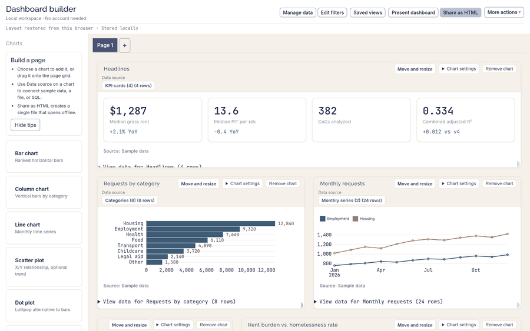

# Dashboard Builder

**A free, local-first dashboard composer.** Drag-and-drop grid, 18 chart and content tile types, in-browser SQL, and one-click export to a self-contained HTML file. No account, no server, no subscription.

**[Open the live demo](https://nateriera.github.io/dashboard-builder/)**



[](LICENSE)
[](https://github.com/nateriera/dashboard-builder/actions)

## Features

- Drag-and-drop, resizable 12-column grid with content-aware tile sizing
- 18 tile types: bar, column, line, scatter + trend, dot, donut, choropleth, small multiples, KPI, table, text/annotation, stacked bar, stacked column, histogram, box plot, area, heatmap, and treemap
- CSV/JSON upload processed locally — your data never leaves the browser — plus built-in sample datasets
- Guided upload summary with column-type and missing-value observations plus explainable chart suggestions
- In-browser SQL via DuckDB-WASM: query your uploads, apply results straight to tiles
- Dashboard category, numeric, and date filters connect explicitly to chart fields, including relative date presets
- Set filters at dashboard, page, or selected-chart scope across named report pages
- Save named dashboard views that restore the active page, filters, parameters, and theme
- Move and resize tiles from the keyboard: **Move and resize** enters arrangement mode, arrow keys move, Shift + arrow keys resize, Enter finishes, and Escape restores every tile on the page to where it was
- Brush a time-series range or select category marks to create independent cross-filters from multiple charts
- Choose whether each category chart filters rows, highlights matching marks, or ignores incoming cross-filters
- Configure chart mark clicks to filter charts, inspect source records, or navigate to a drill-through page
- Inspect source columns in each chart's paginated data table
- Select a category to see its contributing source rows
- **Share as HTML** exports a standalone dashboard with working filters and chart cross-filtering; you add its title, author and data period at share time
- Switch a tile among chart types supported by its current data columns
- Typed parameters — number, text, boolean, date, number range, date range, single select and multi-select — feed SQL `{{name}}` placeholders and transform steps, or bind to a dashboard filter so one control drives it
- Optional per-tile reference lines, with labels, mark targets and thresholds
- Save and reuse local data-wrangling recipes for grouping and calculated fields
- Build ordered transform chains in the Transform tab: GroupBy, day/week/month Bucket, Between, Top, MovingAvg, Stats, Cumulative, Change, paired periods, Pivot, Histogram, and Ratio
- Sort category charts ascending, descending, or by source order; optionally show the top 1–100 categories
- 4 themes, 6 starter templates, save/load multi-page dashboards as JSON
- The exported file is one self-contained, offline HTML document — every page in one scrollable file, labeled as an offline snapshot, with a Restore exported filters button and print rules. Email it or host it anywhere; no server needed
- Data-integrity guardrails: explicit binding modes, visible sampling notices, per-chart data tables

## Quick start

No install needed — open the **[live demo](https://nateriera.github.io/dashboard-builder/)** and start dragging. To run it locally:

```sh
npm ci
npm run dev
```

## Template gallery

Explore three original sample dashboards in the [starter template gallery](docs/template-gallery.md):

- **Executive overview** — KPIs, monthly trend, and category mix.
- **Trend deep dive** — time series, small multiples, and scatter.
- **Geographic snapshot** — state map with supporting metrics.

Choose **More actions → Templates** in the composer to try these or the other three starters.

## Beginner guides

- [Map a CSV to a chart and repair a missing upload](docs/csv-mapping-walkthrough.md)
- [Run a categorical SQL aggregation](docs/sql-aggregation-recipe.md)
- [Choose between JSON backup and HTML sharing](docs/json-backup-html-sharing.md)
- [Filter a dashboard and use parameters](docs/filters-and-parameters.md)

## Start from an upload

Choose **Manage data** and upload a CSV or JSON file to see its row and column counts,
full-file missing-value counts, and inferred column types. Type inference uses
up to 5,000 evenly spaced rows; it is a suggestion, not a change to the source
data. The composer may offer a small set of charts when existing column-name
mapping rules can map the fields conservatively. Review, change field choices,
or uncheck suggestions before building. You can also set the upload as dashboard data or keep the
current dashboard. Profiling and chart suggestions run locally in the browser.

## Contributing

See [CONTRIBUTING.md](CONTRIBUTING.md) for setup, checks, and PR guidelines.
New contributors can browse [good first issues](https://github.com/nateriera/dashboard-builder/issues?q=is%3Aissue%20is%3Aopen%20label%3A%22good%20first%20issue%22).

## Development

### Run and verify

Use Node 24 (the verified test environment) and an installed desktop Google Chrome for browser tests.

```sh
npm ci
npm test
npm run build
npm run test:browser
npm run dev
```

The dev lifecycle builds the export template before starting Vite. Production
builds generate the template and composer together. Vite's runner config loader
avoids the Windows sandbox path traversal encountered with its bundling loader.
The browser suite starts its own local server at port 4173 and uses isolated
browser storage. Close any server on that port first.

The render sweep covers every registry renderer under all four themes (72 cases).
Focused tests cover data correctness, migration, precision, limits and serialized
queries; browser tests use real DuckDB-WASM, fault injection, fresh storage,
keyboard workflows and offline HTML. Evidence and scope are in
[the remediation report](docs/remediation-verification-2026-10-01.md).

## Architecture

### Data and chart contracts

Each tile's Data control offers samples, a mapped upload, SQL, or following the
dashboard default. Missing uploads, queries and SQL tables remain bound to their
original references. A blocking notice offers **Repair data binding**. Choosing
sample data is an explicit action; loading or exporting never substitutes it.

Charts use neutral axis labels until a user enters **X label / unit** or
**Y label / unit** under each tile’s **Chart settings**. These choices travel through autosave, JSON,
templates and HTML. Small-multiple columns use one zero-inclusive domain by
default; disabling Include zero displays a cropped-domain notice.

Donuts combine duplicate labels, sort by contribution and show the largest five
categories plus an explicitly labeled Other bucket when needed. Every
contribution remains in the total. Negative, nonfinite or zero-total inputs
produce a clear unsupported-data state. The eight-category sample totals 48,240.

Chart tiles have an expandable, paginated text table of their authoritative data. The Table tile instead renders the dataset's original columns in a scrollable grid, capped at 500 displayed rows with an explicit notice; annotation tiles have no data table.
Scatter and line plots with more than 2,000 rows show 2,000 evenly spaced rows
and a visible transformation notice. Their underlying rows remain in storage,
JSON, HTML and the text table. Trend lines on sampled scatter plots describe the
sample; use SQL aggregation when an authoritative statistical result is needed.
Category charts refuse more than 100 distinct categories rather than silently omit them. Box plots retain every value for up to 100 distinct labels. Heatmaps permit at most 2,000 unique x/y cells and require duplicate coordinates to be aggregated in SQL first. Treemaps use the optional parent column for one level of grouping.

### Layout schema and replacement

Layouts are written as `app: "dashboard-builder"`, `version: 5`, `rowHeight: 24`,
`savedAt`, optional `meta`, the dashboard default, filters, parameters, saved views,
pages, the current page, theme and tiles. Each tile carries its page, geometry,
metadata and an explicit binding mode:

```json
{
  "app": "dashboard-builder", "version": 5, "rowHeight": 24,
  "savedAt": "2026-11-03T22:00:00.000Z",
  "meta": { "title": "Service requests", "preparedBy": "Ops team", "dataPeriod": "Jan–Dec 2026" },
  "theme": "paper",
  "defaultDataset": { "kind": "samples" },
  "pages": [{ "id": "page-1", "name": "Overview" }],
  "currentPageId": "page-1",
  "filters": [{ "id": "filter-category", "field": "label", "op": "is",
                "values": ["Housing", "Food"], "scope": "charts",
                "targets": [{ "tileId": "requests", "field": "label" }] }],
  "parameters": [{ "name": "categories", "type": "multi-select", "value": ["Housing", "Food"],
                   "source": { "dataset": "categorical", "column": "label" },
                   "options": ["Housing", "Employment", "Health", "Food"],
                   "bindings": [{ "kind": "filter", "filterId": "filter-category" }] }],
  "savedViews": [],
  "tiles": [{
    "id": "requests", "type": "bar", "title": "Requests by category", "source": "Sample data",
    "dataset": "categorical", "binding": { "mode": "explicit", "ref": "categorical" },
    "sizing": "manual", "tileOptions": { "xLabel": "Requests" },
    "pageId": "page-1", "x": 0, "y": 0, "w": 6, "h": 16
  }]
}
```

JSON exports may also carry `datasets`, `queries` and `omittedDependencies`.
A dashboard follower has `dataset: null` and `binding: {mode:"dashboard"}`.
An explicit sample, upload or query reference stays explicit even if it equals a
tile's sample default.

Versions 1 through 5 load; any other version, or a row height other than 24 from
version 3 on, is rejected. Validation clones its input, migrates once and always
returns version 5, so the next save is V5. Version 1 migrates without guessing:
every existing nonnull reference becomes explicit and missing/null references
follow the dashboard. V1 cannot recover historical intent, so it never converts a
matching sample reference into a follower. V1/V2 geometry uses 72px rows;
migration multiplies y/h by three while preserving x/w and data bindings. From V3,
rows are 24px with gutters inside each cell, also used by HTML exports.
Typed parameters arrived in V5: a version 1–4 file that uses a parameter type
other than number or text, a number `step`/`integer` setting, or `bindings` is
rejected with the parameter named rather than silently downgraded.

### Parameters

A layout holds up to 100 parameters with unique names (letters, digits and
underscores, not starting with a digit). The eight types are `number` (optional
min, max, step and integer), `text`, `boolean`, `date` (`YYYY-MM-DD`),
`number-range` and `date-range` (`{from, to}`, one end may be open),
`single-select` and `multi-select`. Select options are refreshed explicitly from
a named sample or uploaded dataset column (not a query or the dashboard default):
values are stringified, missing values skipped, and at most 200 options kept,
with the distinct count recorded when there are more. Values that disappear
from the options are kept and flagged stale.

In SQL, `{{name}}` substitutes only in executable code (never strings or
comments): numbers and booleans as literals, text, dates and selects as quoted
strings, and a multi-select as a parenthesized list for `IN {{name}}` — `(NULL)`
when nothing is selected. Range parameters have no SQL placeholder; using one is
an error that says they substitute through bindings. Any parameter can bind to
one dashboard filter of a compatible operator and field type, and each filter
accepts one parameter; the parameter and the filter then stay in step. Saved
views store parameter values, never bindings.

Manual resize intent is saved with the tile and survives data changes, reload,
import and present mode. **Chart settings → Fit content** chooses automatic sizing.
Plots redraw during pointer resizing and use both available width and height.
Very small manually sized tiles retain one outer scrolling fallback so labels,
source notes and data alternatives remain reachable.

Autosave remains at `dashboard-builder:layout:v1` for storage compatibility.
Imports validate the complete candidate before side effects: own registry types,
unique IDs, bounded finite integer geometry, themes, bindings, options, data,
queries, mappings and size budgets. Conflicting uploaded/query IDs are rejected.
Imports construct controls before persistence, write/read back datasets in one
IndexedDB transaction, and retain a recovery journal at
`dashboard-builder:layout:v1:recovery`. Construction or storage failure restores
the prior grid, queries and layout and rolls back only new import records.
Templates use the same schema validation and preserve chart options.

### Persistence and migration

Uploads live in IndexedDB `dashbuilder`, object store `datasets`; queries live
at `dashbuilder.queries.v1`. Data that cannot persist is labeled session only.
Export JSON provides a backup.

Legacy dataset keys `dashbuilder.datasets.v1` and `klaroDash.datasets.v1` remain
until every record has been written and read back from IndexedDB. Partial writes,
quota failures, unavailable storage and corrupt input retain the original source
and expose a retry action. The old `klaro-dashboard` database is retained after
copying. Failed migrations never claim durable persistence.

### SQL and portability

DuckDB tables use sample keys (`categorical`, `timeseries`, etc.) and
`upload_<id>`. Only one SELECT/WITH query is supported per run. Table
synchronization and execution share one serialized queue. A successful preview
is eligible to Apply only if its immutable SQL, request token and dataset revision
still match. Editing, starting/failing a run, discarding a result, or changing
datasets invalidates eligibility; mapping changes cannot bypass it. Results from
superseded revisions are rejected. Cache identity includes revision and field
contract, and becomes stale as soon as data changes.

Query dependencies conservatively include all registered uploads at Apply;
legacy queries with unknown dependencies include all registered uploads during
export. Arbitrary SQL is not parsed with a best-effort regular expression.
Export JSON includes eligible inputs, saved SQL and mappings. Missing/oversized
inputs and failed queries are listed before downloading; proceeding retains
broken references and an `omittedDependencies` list. Each dataset's inline
budget is 500 KiB. Portability therefore depends on carrying every dependency.
See the [JSON backup and HTML sharing guide](docs/json-backup-html-sharing.md)
for the difference between the editable backup and the standalone viewer.

HTML export carries materialized query results, all tile rows, theme and options;
its viewer runs without SQL or network access. It rejects an export if the
dashboard changes during preparation. Errors remain visible per tile.
**Share as HTML** first asks for an optional dashboard title, preparer and data
period. These are stored on the layout as `meta` and never inferred; blank
fields appear as "Untitled dashboard", "Not provided" and "Not specified". The
viewer opens with an **Offline snapshot** badge, those facts, and the export
time with its UTC offset. Every page is one section of a single document, with
anchor tabs when there is more than one page. Filters stay editable in the
file, and **Restore exported filters** returns them, and any bound parameters,
to the exported state (or to the applied saved view's state).

Static query results belong to one set of parameter values, so SQL-referencing
parameters are frozen at their exported values and listed in a disclosure.
A parameter bound to a dashboard filter and referenced by no SQL stays live in
the viewer as a typed control: a number or text field, a checkbox, a pair of
range bounds, or a select list (date parameters use a text field). A saved view whose parameter values differ from the exported
values, or that lost a detached binding, is disabled in the file with the reason.
New HTML exports also contain an editable layout backup with saved queries and
eligible source datasets. Import reads that backup without running the HTML;
imported queries still require Run and Apply before tiles execute them. The
500 KiB per-dataset backup budget applies, and unavailable dependencies are
reported separately from the materialized viewer rows.

The Data control's Transform tab builds ordered chains of up to 30 steps from
twelve operations: GroupBy, Bucket (day/week/month), Between, Top, MovingAvg,
Stats, Cumulative, Change, paired periods (current vs. previous window), Pivot,
Histogram, and Ratio (a convenience extension). Previews show full per-step
counts, exclusion provenance, and up to five sample rows. Chains retain raw
parameter references and recompile when edited; SQL-only queries remain
editable SQL. See [Transform chains](docs/transform-chains.md) for the contract,
ordering rules, aggregate semantics and limits.

### Exact numbers and dates

Safe SQL integers become Numbers; larger integers become exact decimal strings.
KPI/text fields, IndexedDB and JSON preserve those strings. Numeric plotting
refuses integers outside the safe Number range. Make approximation explicit in
SQL (for example, rounding to a suitable unit) before plotting.

Currency/decimal values requiring exact display must be SQL CAST AS VARCHAR and
mapped to a KPI/text field. Arrow Decimal results require that cast, or an explicit
CAST AS DOUBLE for approximate plotting. Upload JSON must encode unsafe integers
as strings; numeric JSON integers already outside the safe range are rejected.

Date-only strings remain calendar dates. ISO timestamps with offsets and up to
millisecond precision can become line-chart dates. SQL timestamp epoch values
become UTC ISO strings; sub-millisecond values are refused with instructions to
CAST AS VARCHAR to preserve exact text. This is a millisecond Date contract,
not a claim of arbitrary timezone or fractional precision support.

### Budgets, keyboard and offline scope

Engineering limits are separate from measured device capacity:

| Resource | Limit / behavior |
| --- | --- |
| Upload | 16 MiB, 250,000 rows, 100 columns |
| SQL returned rows / columns | 10,000 / 100; add LIMIT or aggregate |
| Dense plotted marks | 2,000, with visible sampling notice |
| Bar-like categories, box plot labels and treemap labels | 100 distinct values, otherwise unsupported-data notice |
| Table tile | First 500 displayed rows, with a visible notice; source data remains intact |
| Heatmap | 2,000 distinct x/y cells; aggregate duplicates or larger matrices in SQL |
| Small-multiple facets | 12, otherwise filter/aggregate notice |
| Layout | 32 MiB, 100 tiles, twelve columns, max geometry 3,000 rows of 24px (same physical limit as legacy) |
| JSON inline data | 500 KiB per dataset; omitted dependencies listed |
| Parameters | 100 per layout; select parameters keep at most 200 options |
| Transform chains | 30 steps; 20 groups/aggregations per step |

Uploads parse in a worker, show progress, and can be cancelled. SQL runs in its
DuckDB worker with a running status. Discarding a running result prevents Apply;
it does not terminate the engine computation. Wait for execution to settle
before the next Run. Returned results are capped before JS materialization.

Core controls are keyboard operable; dialogs enter/trap/return focus and Escape
closes them. Each tile's **Move and resize** button enters keyboard arrangement:
arrow keys move the tile, Shift + arrow keys resize it, Enter keeps the result,
and Escape cancels and restores the geometry of every tile that was on the page
when arrangement started. Moves are announced through the status region. Chart
tables provide text alternatives. The verified editor viewport
is desktop Chrome at 1440×900 and 1024×768. The exported viewer's print rules
keep each tile whole, start each dashboard page on a new sheet, hide interactive
controls, and print a "Filters at print time" summary when filters apply. Chrome print media is
tested; printer-specific output, screen-reader acceptance, mobile editing and
other browser engines are outside the retained acceptance evidence.

Uploaded data is processed locally. The composer loads application assets and
lazy DuckDB/WASM assets from its static host; HTML export fetches a generated
viewer template. These are runtime network requests. Downloaded HTML is tested
with browser networking disabled. Composer startup and first SQL use offline
are not promised; a cache hit is not a verified offline installation mode.

### Templates and release

Six original starter templates and user-saved templates retain theme and tile
options. Applying a template asks before replacing the dashboard. Templates
contain data references, so missing uploads/queries require repair in another
browser. Contributed templates must use original compositions rather than
recreate another creator's dashboard.

Production build output is `dist/`. Publishing, deployment and public release
remain separate owner-authorized actions.

## Stack and licenses

| Dependency | Version | License | Role |
|---|---|---|---|
| [gridstack](https://github.com/gridstack/gridstack.js) | 13.x | MIT | Drag/resize dashboard grid |
| [@observablehq/plot](https://github.com/observablehq/plot) | 0.6.x | ISC | Chart rendering |
| [d3-shape](https://github.com/d3/d3-shape) | 3.x | ISC | Donut arcs |
| [d3-hierarchy](https://github.com/d3/d3-hierarchy) | 3.x | ISC | Treemap layout (installed package license verified) |
| [d3-interpolate](https://github.com/d3/d3-interpolate) | 3.x | ISC | Color ramps |
| [htl](https://github.com/observablehq/htl) | 0.3.x | ISC | HTML/SVG templating |
| [d3-dsv](https://github.com/d3-dsv) | 3.x | ISC | CSV parsing for uploads |
| [@duckdb/duckdb-wasm](https://github.com/duckdb/duckdb-wasm) | 1.32.0 | MIT | In-browser SQL, lazy-loaded |
| [topojson-client](https://github.com/topojson/topojson-client) | 3.x | ISC | TopoJSON → GeoJSON (choropleth) |
| [idb](https://github.com/jakearchibald/idb) | 8.x | ISC | IndexedDB wrapper (upload store) |
| [vite](https://vite.dev/) (dev) | 7.x | MIT | Build tooling |

This project itself is **MIT** (see `LICENSE`). Browser test tooling uses
`@playwright/test` and `fake-indexeddb`, both Apache-2.0 according to their
installed package metadata.
