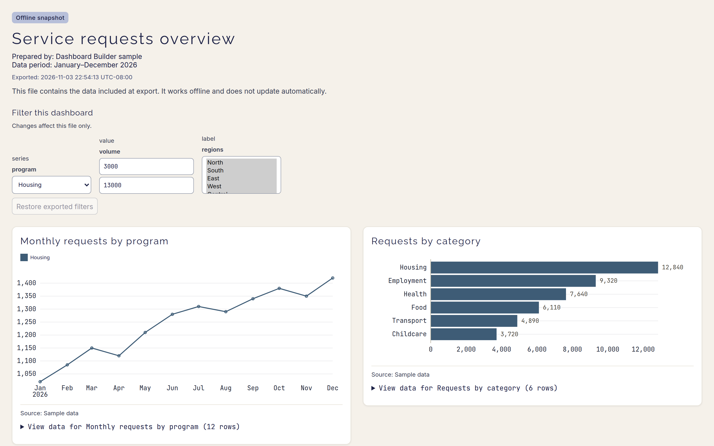

# Dashboard filters and parameters

Dashboard Builder can filter matching tiles and use typed, named values in SQL queries, transform steps and dashboard filters. These controls are saved with the dashboard and work locally in your browser.

## Add a dashboard filter

Choose **Edit filters**, then **Add filter**. Select a source chart and field, then choose values for a category or enter a number or date range. Date ranges include both calendar dates and offer last 7 days, last 30 days, month-to-date, last month, and year-to-date presets. Time-series charts also accept a drag selection over the x-axis to create a date cross-filter. The list offers up to 200 distinct categorical values; when a field has more, narrow the data first.

Choose **Dashboard** to apply a filter wherever the matching field exists, **Page** to limit it to one report page, or **Selected charts** to map it to specific charts and fields. Page-scoped filters stay with that page as you navigate.

Each filter shows the charts it affects and the field used in each chart. Matching field names are connected automatically; change a chart's field or choose **Do not filter** to scope the control. This lets one dashboard filter connect fields with different names while leaving unrelated charts unchanged. Older saved filters without explicit connections keep their prior same-name behavior. A filter that leaves a chart with no rows shows a neutral empty message. Remove a filter from its chip in the Filters tab.

Date fields are inferred from ISO date and timestamp values. Date filters compare calendar dates, so a selected end date includes rows later that day when the source contains timestamps. Date input values are stored as `YYYY-MM-DD` strings.

## Cross-filter from a chart

Activate a category mark in a bar, column, dot, stacked bar/column, or donut chart to create a cross-filter from that source. Selections from different charts remain independent and combine. Focus a mark and press Enter to use it with the keyboard. Hold Control or Command while selecting to add or remove values; click the same mark again, or clear its chip in **Edit filters**, to remove the selection. Each category chart can filter incoming selections, highlight matching marks, or ignore them. In a donut's **Other** slice, the filter includes the categories combined into that slice.

Open a tile's **Settings** to choose whether mark activation filters charts, inspects the contributing records, or does both. You can also send a mark selection to another report page; the selection becomes a cross-filter on matching fields on that page. The record table is paginated and includes source columns.

Selections support mouse, touch, and keyboard activation. Multi-selection uses Control or Command with the keyboard or pointer.

## Use a parameter

Choose **Edit filters** → **Parameters** → **Add parameter**. Give it a name made of letters, numbers, or underscores (starting with a letter or underscore), then choose a type. A dashboard can hold up to 100 parameters.

| Type | Value |
| --- | --- |
| **Number** | A number. Optional minimum, maximum, step, and whole-number setting; with both bounds set, a slider appears beside the value. |
| **Text** | Any text up to 10,000 characters. |
| **Boolean** | On or off. |
| **Date** | A calendar date (`YYYY-MM-DD`). |
| **Number range** / **Date range** | A from/to pair; one end may be left open. |
| **Single select** / **Multiple select** | One value, or a set of values, from a list of options. |

Select options come from a column of a sample or uploaded dataset that you choose explicitly (not a query or the dashboard default). Choose **Refresh options** to read them: values become text, missing values are skipped, and at most 200 options are kept; when the column has more, the parameter records how many distinct values it found. A selected value that later disappears from the options is kept and flagged as stale rather than silently changed.

### In SQL

Reference a parameter in a SQL tile with double braces:

```sql
SELECT *, value * {{growth}} AS projected FROM categorical
SELECT * FROM categorical WHERE label IN {{categories}}
```

Placeholders are replaced only in executable SQL, never inside strings or comments; write them unquoted. Numbers and booleans become literals. Text, dates, and single selects become quoted strings with apostrophes escaped, so `O'Brien` becomes a valid SQL string. A multiple select becomes a parenthesized list for `IN`, or `(NULL)` when nothing is selected. Range parameters have no SQL placeholder: they work through a filter binding, and using one in SQL shows an error saying so. A missing parameter shows an error that names it and points to the Parameters tab. Changing a parameter re-runs SQL tiles that use it.

Transform steps can also reference parameters: Between bounds, the Top count, the MovingAvg window, Histogram bounds, paired-period window lengths, and a Bucket grain held in a text parameter. See [Transform chains](transform-chains.md).

### Bind a parameter to a filter

Under **Filter binding**, connect a parameter to one dashboard filter. The filter's operator and field type must match: number, text, boolean, date, and select parameters bind to an *is* or *is not* filter, a number range to a numeric range filter, and a date range to a date range filter, on a field whose values have the matching type. Each filter accepts one parameter. Once bound, changing the parameter changes the filter and the other way round; if they ever disagree, the conflict is shown rather than resolved silently.

## Sort, limit, and reference lines

Bar, column, and dot charts can sort descending, ascending, or in source order. Category sorting is based on the value field. **Show top N categories** keeps the selected number of categories after sorting; rows are then passed to the chart's integrity checks. The remainder is omitted, not grouped as **Other**. Stacked charts rank categories by their combined series total and keep every series row for selected categories. Donut charts keep their existing top-five-plus-Other display so the whole remains readable; they do not use the top-N control.

Charts with numeric value axes can show an optional reference value and label. Clear the value to turn the line off. A reference line can extend beyond the data range, including to zero or a negative number.

## Change a chart type

Open a tile's **Settings** and choose **Chart type**. The list is limited to chart types whose required fields are present in the tile's current data. The data connection stays attached to the tile; type-specific settings reset when the chart changes.

## Save and share

Filters, parameters, report pages, and saved views are included in saved layouts and JSON backups. Choose **Saved views** → **Save current view** to keep the current page, filters, parameter values, and theme; select a view and choose **Apply selected view** to restore it. Saved views store parameter values, not filter bindings.

**Share as HTML** materializes each tile's rows and filter definitions so category, numeric, and date filters still work offline, and **Restore exported filters** returns them to the exported state. The offline file does not run SQL, so parameters referenced by SQL are frozen at their exported values and listed at the top of the file. A parameter bound to a filter and not referenced by any SQL stays live as a control in the file. A saved view is available in the file only when its parameter values match the exported ones; otherwise it is listed as disabled with the reason. Wrangling recipes are stored locally in the current browser and can be loaded into a later pivot or calculated-field session.



The exported viewer keeps bound single-select, range, and multi-select parameters as live controls, while SQL-referencing parameters are frozen and disclosed.
