# Template gallery

Open [Dashboard Builder](https://nateriera.github.io/dashboard-builder/), choose
**More actions** → **Templates**, then select **Use template** and confirm
**Replace** for a template below. Replacement changes the current dashboard; use
**More actions** → **Export JSON** first to keep a backup.
These original layouts use built-in sample data, not client records: the
Meridian County figures are synthetic, for a fictitious jurisdiction.
The templates appear here in the same order as the in-app gallery.

## Homeless system performance (CoC)

KPI strip of System Performance Measures, exits by destination, small multiples
by race, and a year-over-year measures table.
Use this to report whether a homeless response system is housing people faster,
keeping them housed, and doing it equitably.

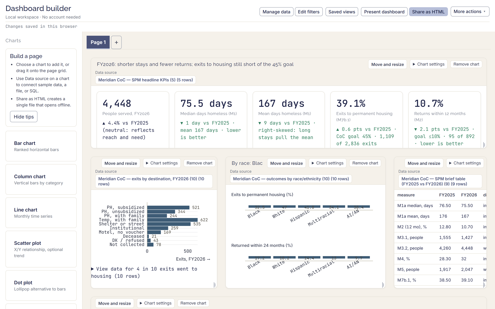

## Behavioral health quality (CCBHC)

KPI strip, measures against benchmark, a site-level remission trend, PHQ-9
outcome bands by site, and a full measures table with numerators and
denominators.
Use this for a clinic or CCBHC quality review.

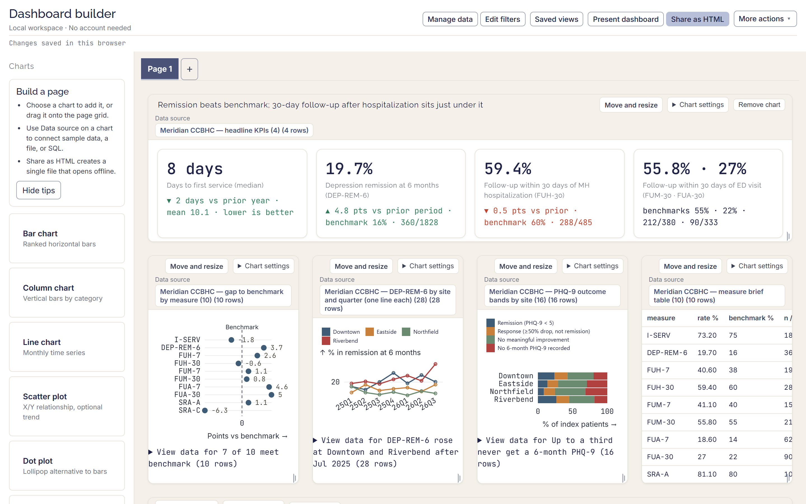

## Health center quality (UDS)

KPI strip, yearly clinical quality measures, measures against national rates,
and payer mix by year.
Use this for a community health center's UDS-style quality summary.

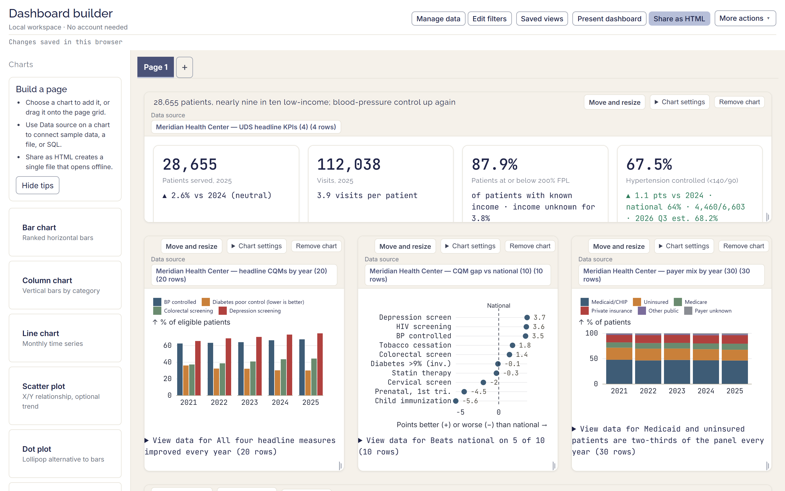

## Overdose & SUD community surveillance

KPI strip, the overdose death-rate trend, deaths by drug, a state map, and the
highest state rates.
Use this for public-health surveillance of overdose and the response to it.

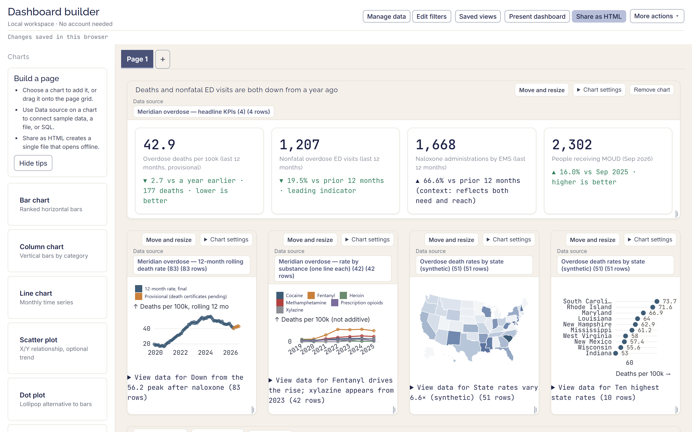

## Community health by place

KPI strip, a state map of uninsured rates, the highest rates, an uninsured vs
early-death scatter plot, and county vs state vs U.S. comparisons.
Use this to show where a community stands against its state and the nation.

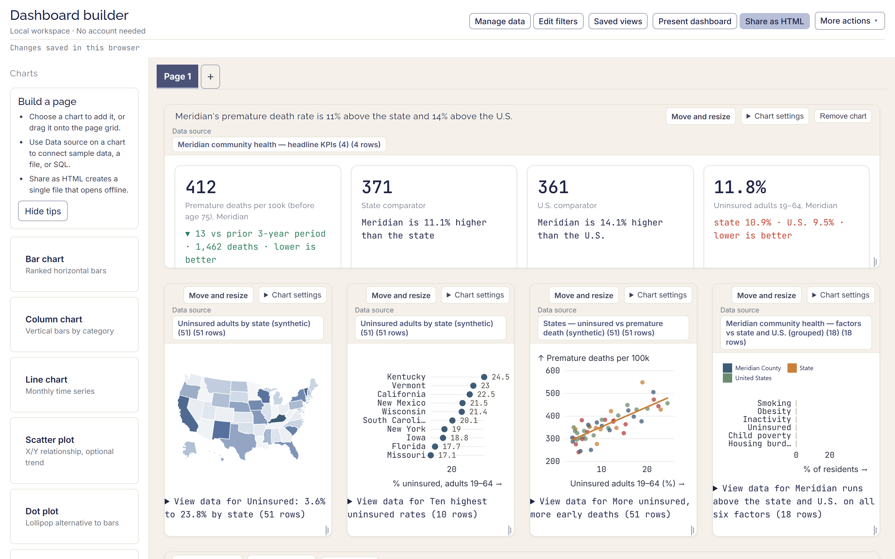

## Program outcomes & funder report

KPI strip, outcomes by program as small multiples, and participants compared
with the service area.
Use this for a funder report on reach, outcomes and what will change.

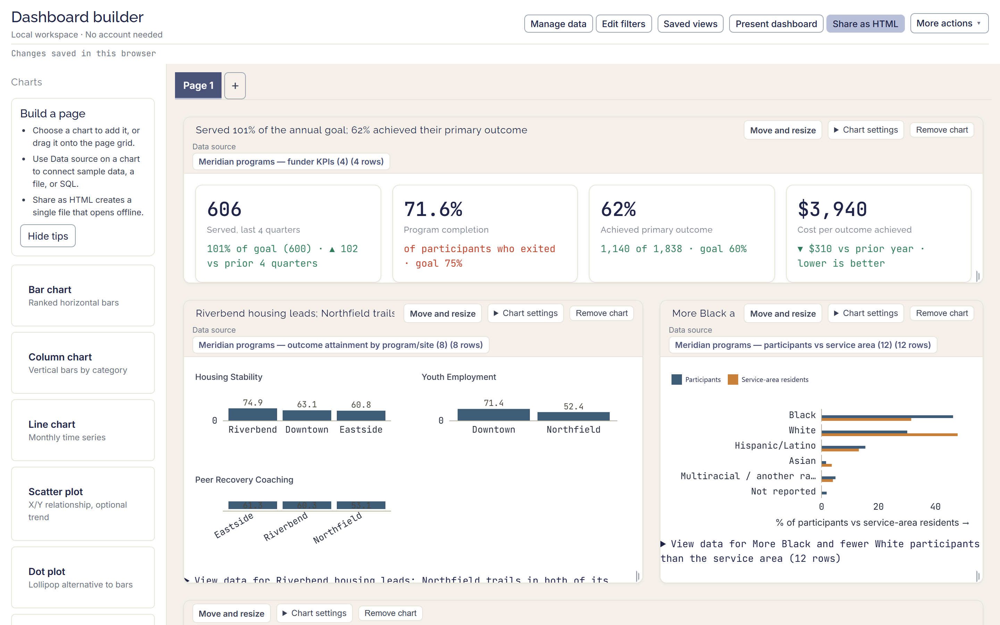

## System flow: inflow, outflow & actively homeless

KPI strip, monthly inflow and outflow, the actively homeless count, and the
count by household type.
Use this to track a by-name list month by month.

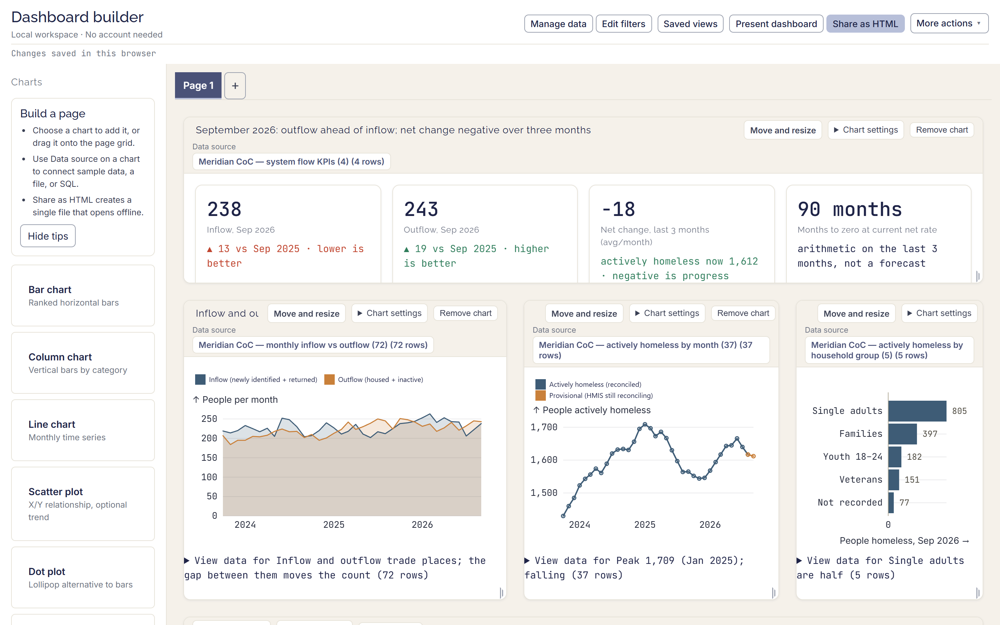

## City services: 311 operations

KPI strip, daily requests opened and closed, days to close against target,
district comparison, and a request-type table.
Use this for city operations staff watching timeliness and backlog.

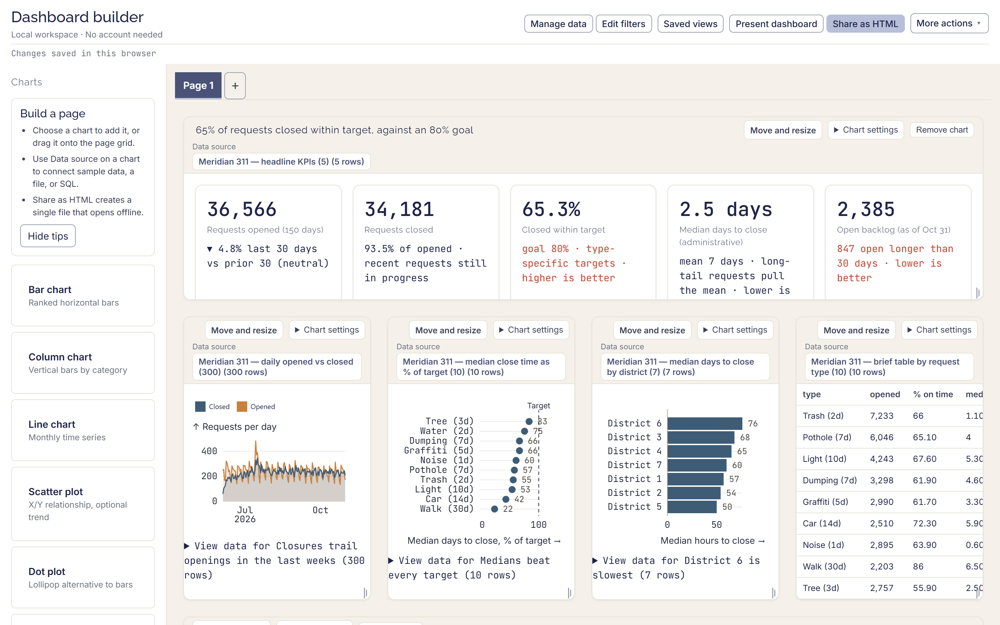

## Performance scorecard (targets & thresholds)

KPI strip, a scorecard table with printed status thresholds, and quarterly
trends by perspective.
Use this for a leadership scorecard of commitments on, near and off target.

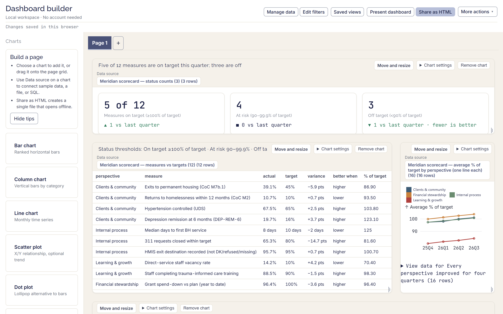

## Executive overview

KPI strip, monthly revenue against last year, functions against budget, and
actual vs budget by function.
Use this as a starting point for a leadership summary.

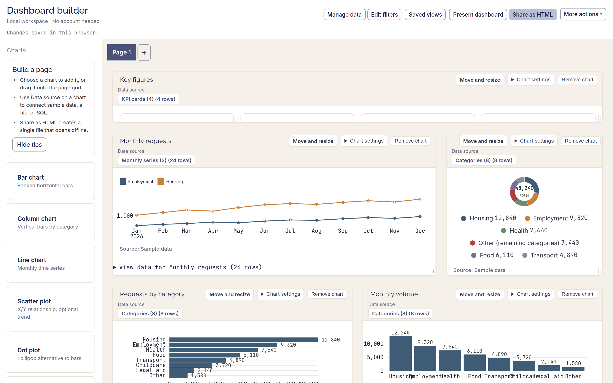

## Sales performance

KPI strip, reps against quota, monthly bookings against last year, open
pipeline by stage, and deal size vs days to close.
Use this for a sales team's forecast and pipeline review.

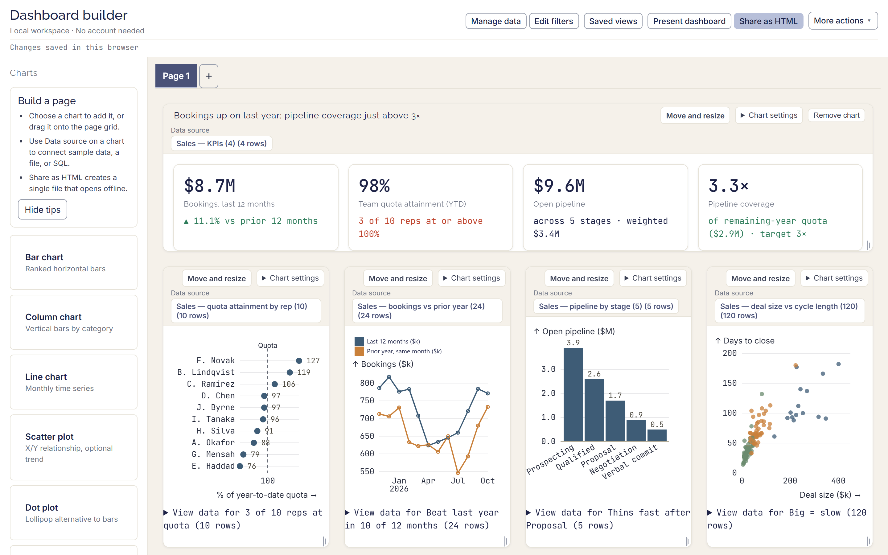

All eleven template definitions live in [src/templates.js](../src/templates.js).
This page embeds the captures in `docs/screenshots/`. The in-app gallery shows
bundled thumbnails for the built-in templates and schematic previews for custom
saved templates, so private chart contents are not captured into an image.
Custom uploads and saved queries must travel with your dashboard to work in
another browser; missing data references require repair.
