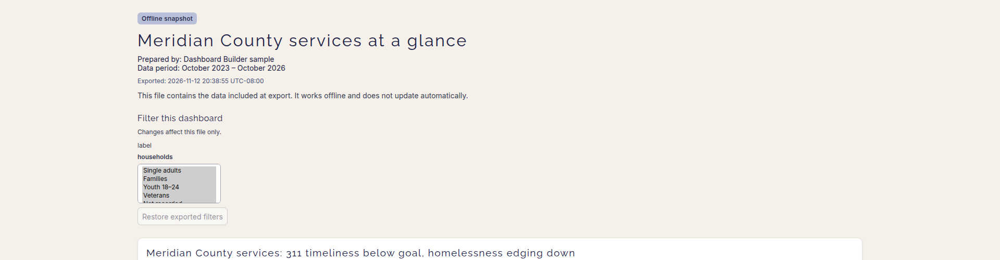
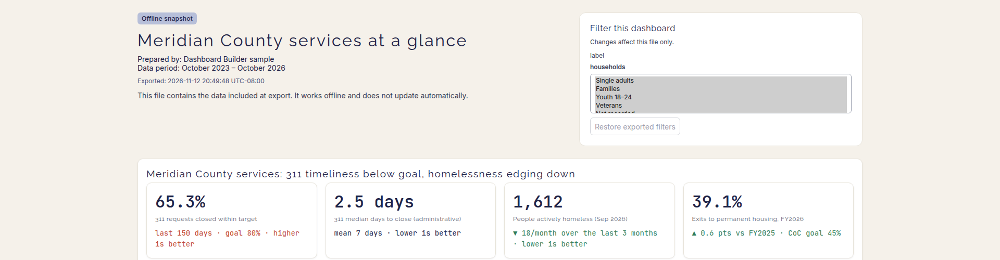
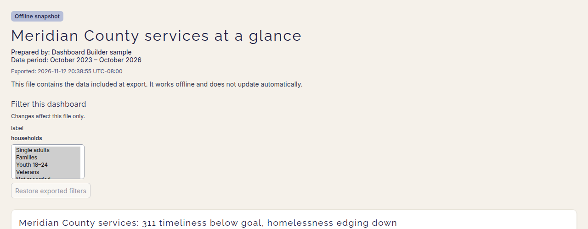
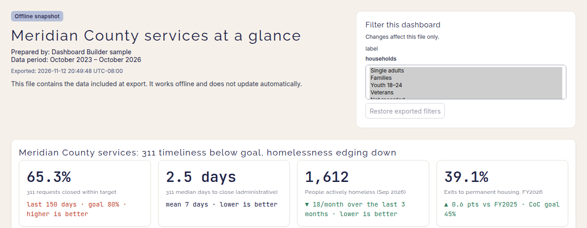

# Export head layout

## §0

Verified Cinder's authorized pre-fetched local `origin/main` at `d71ac4d0e628468ba918a2eee35dc8f14cf12c6e` before cutting `fix/export-head-layout`. The branch-point suites ran unsandboxed through the approved standalone commands: node **225/225**, sweep **ALL 72 OK**, browser **223 passed (6.6m)**. The node run includes the spawn-bound template generator. No partial result is used as a suite count.

Before-captures export the current starter with the film's single `households` multi-select parameter, bound to the household bar's chart-scoped filter. The film's title, prepared-by and data-period text are used. The current starter's chart composition is retained; the film itself is untouched. The actual downloaded, self-contained HTML was opened locally for captures at 1920×1080 and 1280×800. The comparison images below show the top 500px of those viewports; full viewport captures and the before HTML remain in `output/export-head-layout/`.

## Layout and judgments

The change is **CSS only** in `src/export/style.css`. Viewer JavaScript, template markup, payload schema and export format are unchanged. The existing build regenerates the ignored `public/export-template.html` from that source.

At screen widths **1000px and above**, a conditional grid gives the head 3/5 and the first page's filter card 2/5 of the available width, separated by 32px. The right track has a 320px minimum. The badge/title/facts/note remain left; the filter heading/caption/controls/restore action form a white, bordered card with 20px padding. The normal 1440px document cap and full-width KPI/chart grids remain. The note and freeze disclosure retain a 72ch maximum measure.

The first page uses `display: contents` **only when it has a functional filter group at a wide screen size**, projecting its existing card into the head row. Its DOM, labelled page section, control ownership and handlers remain intact. Saved views, page tabs and the first page heading span rows below the head; later pages keep their own filter groups. Their chart grids and headings are not moved to the global head. The first page's original end spacing is preserved after its projected chart grid.

Below **1000px**, all original block/DOM ordering applies: head first, then the existing saved-view/navigation/page content and filter group. At print time the screen-only grid does not apply, so the existing page boxes, breaks, hidden controls and filter summaries are unchanged. No-filter exports never activate the grid, show no empty card, and retain a full-width head. A chart selection can activate the card and clearing/restoring it returns to the full-width state. Multiple controls wrap within the card and grow its height without an artificial height limit.

The two added browser tests cover 1920, 1280 and the 1000px boundary; stacking at 999 and 360px; no filters, several filters, dynamic chart selections, filter/restore operation and print flow. The existing viewer suite verifies saved views, page-scoped/synchronized filters, tab anchors, metadata and offline operation.

## Before / after

### 1920×1080 viewport, top 500px

Before:

After:

### 1280×800 viewport, top 500px

Before:

After:

## Validation / handback

Head: **node 225/225; browser 225 passed (5.8m, zero flaky); sweep ALL 72 OK**. Production build and diff checks pass. No checks remain deferred. Port 4173 is verified free after the test server stopped.

| Viewport | Head width | Filter card position / width | First grid top, base → head |
|---|---:|---|---:|
| 1920×1080 | 816px | x=1112px, y=24px / 544px | 445.4px → 293px |
| 1280×800 | 720px | x=776px, y=24px / 480px | 445.4px → 293px |

Export timestamps differ between the actual before/after downloads; source copy and metadata inputs are identical. Two browser tests added; no node count change. Viewer behavior checks pass and no source data changes were made. Before final worktree review, tracked browser-generated screenshots and diagnostics are restored to HEAD; only the explicitly requested new comparison captures are committed.

Not done: film re-capture (out of scope), Cinder review and Nate's merge.
